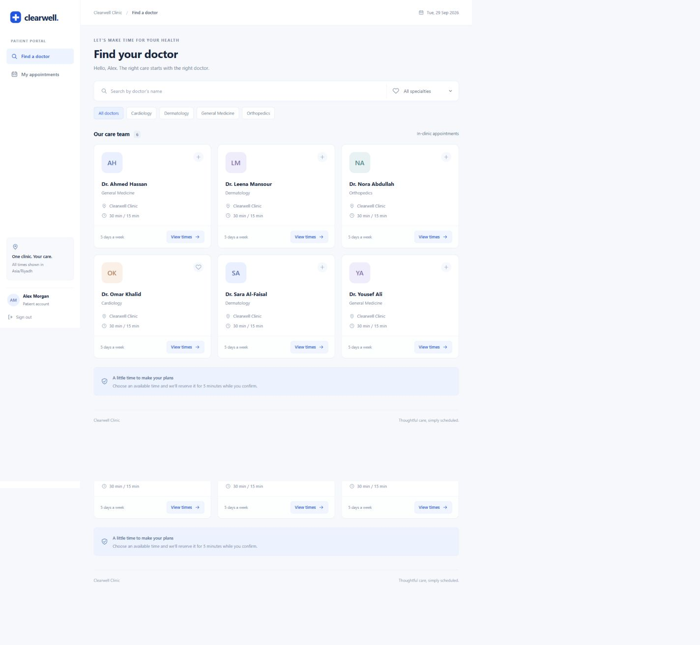
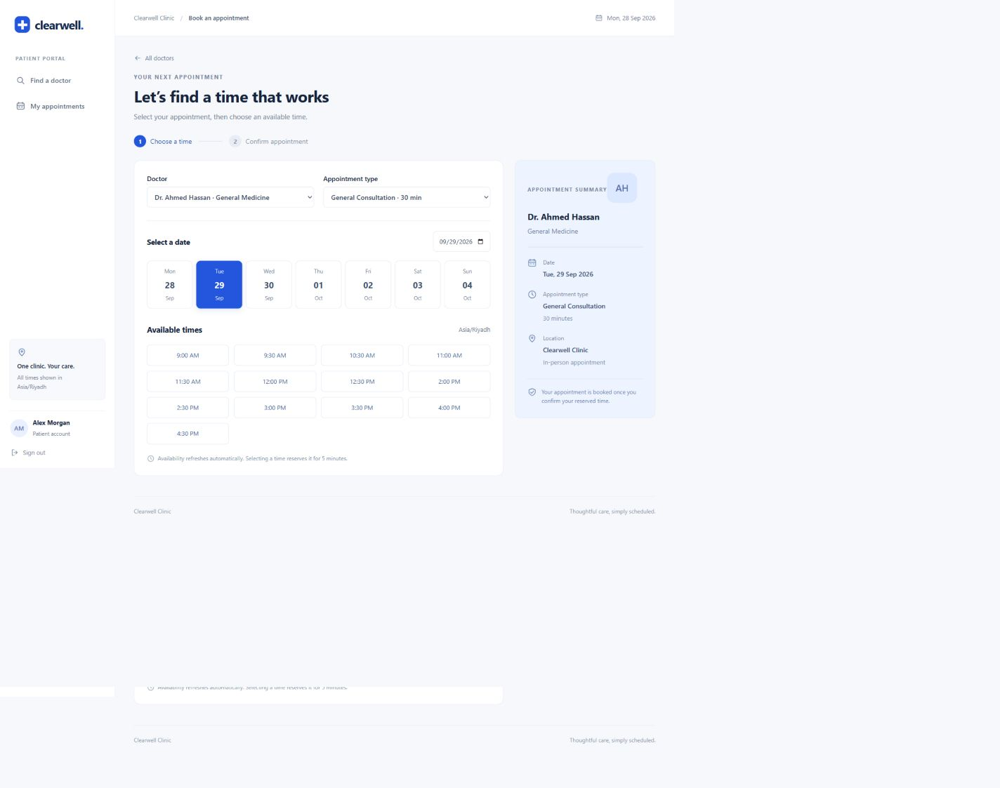
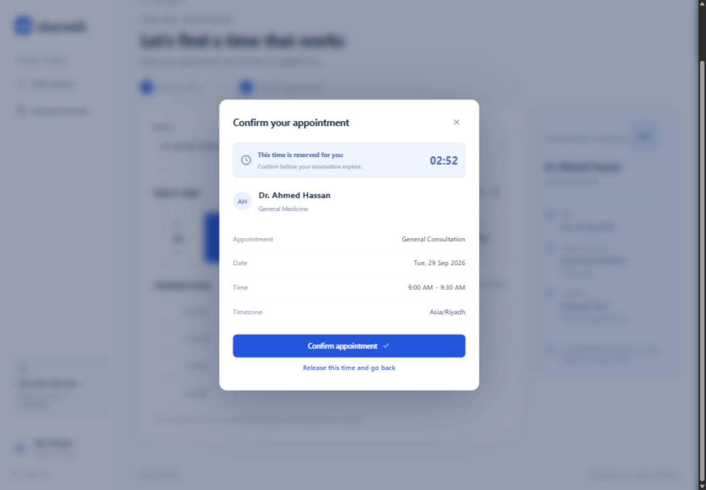
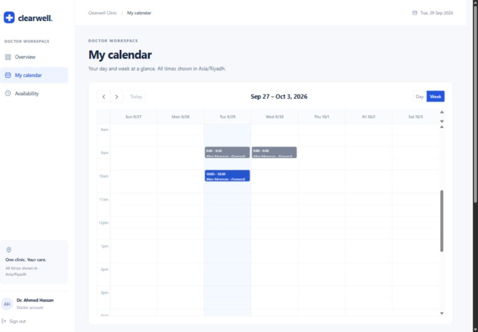

# Clearwell Clinic — Appointment Booking

A full-stack, single-clinic appointment application built from the supplied BRD. Patients browse doctors, reserve a time for five minutes, confirm, cancel, and safely reschedule. Doctors manage working hours, time off, their calendar, and appointment outcomes. Administrators manage the care team, specialties, appointment types, users, and appointments.

## Technology

React 19, TypeScript, Vite, React Router, Tailwind CSS 4, FullCalendar, NestJS 11, Prisma 6.19, PostgreSQL, JWT, Argon2id, Jest, and Supertest. Dependency versions are locked in `package-lock.json`. No Docker, payments, notifications, medical records, profile photographs, or external calendar integration.

## Run locally

Requirements: Node.js 22.12 or newer, npm, and PostgreSQL 16 or newer. PostgreSQL must include the `btree_gist` extension (included in the standard distribution). The project was verified with Node.js 24 and PostgreSQL 18.

1. Create a PostgreSQL login and two databases, using an administrator account. Use your own password when prompted:

   ```sh
   createuser --pwprompt clinic
   createdb -O clinic clinic
   createdb -O clinic clinic_test
   ```

2. From this directory, install dependencies:

   ```sh
   npm ci
   ```

3. Copy `apps/api/.env.example` to `apps/api/.env`. Set database credentials, a random `JWT_SECRET` of at least 32 characters, and `ADMIN_PASSWORD`. Generate a secret with:

   ```sh
   node -e "console.log(require('crypto').randomBytes(48).toString('hex'))"
   ```

4. Apply migrations and create the administrator and initial catalog:

   ```sh
   npm run setup
   ```

5. Start the backend and frontend together:

   ```sh
   npm run dev
   ```

   Open [the local application](http://localhost:5173). The API listens on `127.0.0.1:3001`. Vite proxies `/api` to the backend. To start separately, use `npm run dev -w apps/api` and `npm run dev -w apps/web` in separate terminals.

6. Sign in with your configured administrator account. Add doctors, assign appointment types, and set working hours. Patients can register from the sign-in page.

### Optional sample data

Set `SEED_DEMO=true` and set `DEMO_PASSWORD` before running `npm run db:seed`. This creates six sample doctors, a patient, Sunday–Thursday split working hours, and a future sample appointment. Rerunning the seed preserves existing passwords and records. Sample accounts are `patient@clinic.test`, `ahmed@clinic.test`, `sara@clinic.test`, `omar@clinic.test`, `nora@clinic.test`, `yousef@clinic.test`, and `leena@clinic.test`; they share your configured demo password. Use only fictional data in a demo.

The prepared local workspace has already been configured. See [LOCAL-DEMO.md](LOCAL-DEMO.md) for its running addresses and sample credentials.

## Environment variables

| Variable                         | Purpose                                                     |
| -------------------------------- | ----------------------------------------------------------- |
| `DATABASE_URL`                   | PostgreSQL connection for the application                   |
| `TEST_DATABASE_URL`              | Dedicated test database, with a name ending in `_test`      |
| `JWT_SECRET`                     | Random signing secret, minimum 32 characters                |
| `CLINIC_TIMEZONE`                | IANA timezone; defaults to `Asia/Riyadh`                    |
| `FRONTEND_ORIGIN`                | Allowed browser origin; defaults to `http://localhost:5173` |
| `HOST` / `PORT`                  | API bind address / port; defaults to `127.0.0.1` / `3001`   |
| `ADMIN_EMAIL` / `ADMIN_PASSWORD` | Initial administrator credentials for seeding               |
| `SEED_DEMO` / `DEMO_PASSWORD`    | Opt-in fictional accounts and schedules                     |

`.env` files and database data are ignored by Git. The browser uses same-origin `/api` requests; there are no frontend secrets.

## Roles and routes

| Role    | Capabilities                                                                                                | Starting page       |
| ------- | ----------------------------------------------------------------------------------------------------------- | ------------------- |
| Patient | Self-registration, doctor search, holds, booking, own appointments, cancellation, rescheduling, profile     | `/doctors`          |
| Doctor  | Own dashboard, day/week calendar, working hours, blocked time, ended appointment outcomes                   | `/doctor/dashboard` |
| Admin   | All appointments, doctors and their schedules, specialties, appointment types, account activation, outcomes | `/admin/dashboard`  |

Every protected endpoint validates the JWT and reloads the user's current status and role. Public registration only creates patients. Tokens expire after eight hours, are stored in browser session storage, and are revoked server-side on logout or account status changes. Logout ends all sessions for that user. Password hashes are never serialized to the browser. Login and registration are rate-limited. API bodies reject unexpected fields.

## Booking and concurrency

1. Available times are generated from working windows and the chosen duration in the configured clinic timezone.
2. Confirmed appointments, blocked periods, and unexpired holds are excluded for both the doctor and the patient.
3. Selecting a time creates a separate `TemporaryHold` lasting exactly five minutes according to server time.
4. Confirmation verifies ownership, expiry, doctor/type validity, duration, working hours, and conflicts again, then consumes the hold and creates one `CONFIRMED` appointment in one transaction.
5. Retrying the same successful confirmation returns the existing appointment. Holds are never represented as a pending appointment status.

All scheduling mutations share a transaction-scoped PostgreSQL advisory lock. SQL triggers mirror holds, confirmed appointments, and blocked time into a common occupancy table. GiST exclusion constraints prohibit overlapping doctor periods and overlapping patient periods, including inserts made directly into the source tables. Intervals use `[start,end)`, allowing adjacent visits. Expired occupancy is removed under the same lock; availability always checks expiry explicitly, so no timer or cleanup job is required for correctness.

Rescheduling acquires a hold bound to the original appointment. A single transaction consumes that hold, cancels the original, creates the replacement, and links the history. Any failure rolls everything back. The original remains reserved until commit. See [architecture and ERD](docs/ARCHITECTURE.md) for details and tradeoffs.

## Build and test

```sh
npm run build
npm test
npm run test:integration
```

The integration command migrates the dedicated test database before running. **Integration tests clear records in that database. Never point `TEST_DATABASE_URL` at application data.** The name suffix check is an additional guard.

The automated suite covers registration, authentication, disabled accounts, authorization, durations, slot generation, active/expired holds, doctor and patient overlaps, simultaneous attempts, idempotent confirmation, direct SQL protections, cancellation, safe rescheduling, schedule-edit conflicts, and final outcomes. Results and browser checks are recorded in [VALIDATION.md](docs/VALIDATION.md).

Build artifacts are `apps/api/dist` and `apps/web/dist`. `npm run start -w apps/api` starts the compiled API. `npm run preview -w apps/web` previews the frontend build; the preview also uses the Vite proxy. For an actual deployment, serve the frontend and route same-origin `/api` traffic to the NestJS process, configure HTTPS and the allowed origin, provide PostgreSQL, and run `npm run db:migrate`. This delivery runs locally; no public hosting or GitHub repository has been created.

## Screenshots









Additional screenshots, including mobile booking, are in `docs/screenshots`.

## Project structure

```text
apps/api/
  src/auth.ts             JWT, Argon2, current-user and role enforcement
  src/clinic.ts           Catalog, doctors, schedules, users, slots
  src/appointments.ts     Hold, confirmation, cancellation, reschedule, outcomes
  src/scheduling.ts       Timezone-aware slot generation and conflict rules
  src/db.ts               Prisma and transaction boundary
  prisma/schema.prisma    Relational data model
  prisma/migrations/      Initial schema and database integrity constraints
  prisma/seed.ts          Administrator, initial catalog, optional sample data
  test/                   Unit and real-PostgreSQL HTTP integration tests
apps/web/src/
  api.ts                  API client and shared frontend types
  context.tsx             Authentication and clinic configuration
  patient.tsx             Doctor directory and booking
  appointments.tsx        Appointment lists, details, dashboards, calendar
  admin.tsx               Catalog, accounts, doctors, availability management
  ui.tsx                  Accessible dialogs, form fields, feedback, shared hooks
docs/                     Architecture, API reference, validation, screenshots
scripts/                  Dedicated test database migration helper
```

## Defined implementation rules

The BRD leaves a few operational choices open. This version uses a 365-day booking horizon and limits each patient to three simultaneous active holds. New slot starts are aligned to the selected duration from the beginning of each working window. Reschedule holds cannot overlap the original appointment; choose a non-overlapping replacement period. Completion and no-show are allowed only after the appointment ends. Working windows cannot cross midnight; use two windows on adjacent days. Blocked periods may cross dates. Existing future appointments prevent conflicting availability edits and blocked time. Deactivation prevents access/new bookings while preserving existing appointments for administrators to resolve explicitly. Historical start/end times and the booked specialty remain attached to the original appointment.

Timezone conversion uses Luxon and UTC-backed PostgreSQL timestamps. On daylight-saving changes, nonexistent local times and appointments crossing an offset transition are not offered. The default Riyadh timezone has no DST.

## Future improvements

For a larger clinic, replace the clinic-wide lock with ordered per-resource locks and add pagination. Password recovery, audit logs, multi-instance shared rate limiting, notifications, and deployment operations can be added in a later version. They are not part of this BRD's V1 delivery.
