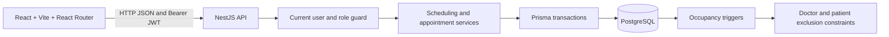
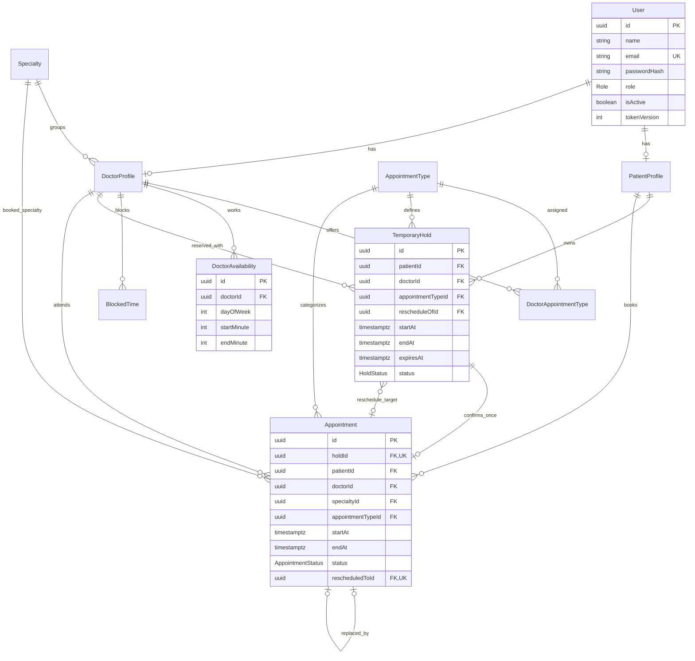
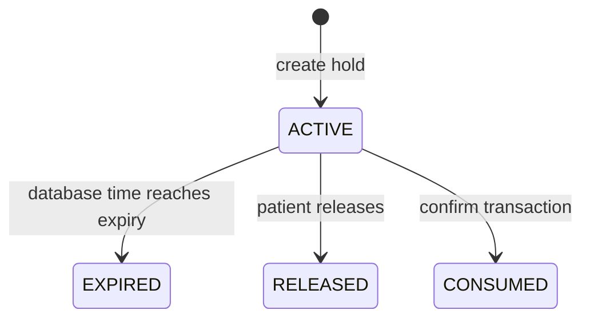

# Architecture and database design



The frontend is a client application. FullCalendar renders events and never determines whether a booking is allowed. NestJS validates input, current user status, ownership, scheduling rules, and status transitions. Prisma accesses PostgreSQL, and custom SQL migrations supply features beyond the Prisma schema language.

## Entity relationship diagram



`ScheduleOccupancy` is a supporting projection maintained by database triggers. Its key is `<source-table>:<uuid>`. It contains a doctor, an optional patient, a time range, and an optional expiry. The triggers remove occupancy when an appointment leaves `CONFIRMED`, a hold leaves `ACTIVE`, or blocked time is removed. No client or API route can edit this projection directly.

## Transaction ordering

All scheduling changes first acquire `pg_advisory_xact_lock(73429101)`. This clinic-wide lock deliberately favors simple correctness for a single clinic. The transaction runs at READ COMMITTED so each query after a waited lock reads committed state. Database clock time is read after acquiring the lock; expired active holds are marked expired within the same transaction.

SQL statement triggers on holds, appointments, and blocked time take the same lock and delete expired occupancy before row triggers synchronize the projection. Therefore direct writes to these source tables still reach the common constraints. The database's exclusion constraints cover **all** occupancy kinds:

```sql
EXCLUDE USING gist (
  "doctorId" WITH =,
  tstzrange("startAt", "endAt", '[)') WITH &&
);
```

A second constraint applies the same rule to non-null `patientId`. Scheduling reads use original hold expiry rather than relying on projection cleanup. UTC-backed `timestamptz` values represent instants; weekly working windows are local clinic wall-clock minutes. Half-open intervals allow back-to-back visits.

The lock serializes schedule edits, doctor activation/type assignments, appointment type edits, holds, confirmation, cancellation, blocked time, and outcomes. No network requests occur inside these transactions. Slots are generated on demand, not stored permanently. Availability is a snapshot; creating a hold always checks it again.

For a larger installation, use ordered per-doctor/per-patient locking with the same exclusion constraints. This would need new cross-doctor concurrency tests and careful handling of catalog edits. The present implementation is intentionally for the BRD's single-clinic scale.

## Hold and reschedule lifecycle



The confirmation transaction checks ownership, expiry, future start, doctor activation, supported active type, unchanged duration, working windows, and all overlaps. It consumes the hold before inserting the appointment so the appointment does not collide with its own hold. A unique `holdId` makes confirmation idempotent. Failure rolls back both the hold and appointment changes.

For rescheduling, `rescheduleOfId` binds the new hold to the original appointment. The original is checked again at confirmation. The transaction consumes the new hold, cancels the original, inserts the new appointment, and saves `rescheduledToId`. A forced database-failure test verifies the original and hold are restored if insertion fails after the cancellation statement.

New reschedule periods cannot overlap the original appointment. This preserves the literal BRD rule that a patient's active hold cannot overlap an existing confirmed appointment, while the original remains valid throughout the process.

## Appointment outcomes

Only `CONFIRMED → COMPLETED`, `CONFIRMED → CANCELLED`, and `CONFIRMED → NO_SHOW` are exposed. Doctors/admins record completion/no-show after the appointment end. Patients/admins cancel before the start. A trigger protects terminal history against later changes, apart from the replacement link and technical update timestamp.

Schedule edits cannot exclude any confirmed appointment whose end is in the future, or any active hold. Block creation rejects conflicts explicitly. Doctor or account deactivation does not silently cancel appointments. Existing appointments remain visible to the administrator for resolution.

## Security and deployment boundaries

Argon2id hashes passwords. Signed JWTs expire after eight hours and have fixed audience/issuer. Every protected request reloads the current user, checks activation and token version, and applies role/ownership authorization. DTOs reject unexpected fields, invalid UUIDs, non-positive durations, malformed timestamps, and whitespace-only required strings. User creation, serialization, and registration never accept client-selected roles or return password hashes.

The browser stores the JWT in session storage. A production host should use HTTPS and protect against injected scripts; an HttpOnly-cookie design would be a separate authentication change requiring CSRF protection. NestJS uses Helmet and bounded in-process rate limiting. Horizontally scaled hosting would require a shared rate-limit store. There are no medical records or billing data in this application.

The database account used at runtime should not be shared with end users. Database owners can alter triggers/constraints; no database design protects against a malicious privileged owner. Apply migrations with an appropriate migration account and restrict runtime schema privileges for deployment.

## Primary implementation references

- [PostgreSQL exclusion constraints](https://www.postgresql.org/docs/18/ddl-constraints.html#DDL-CONSTRAINTS-EXCLUSION)
- [PostgreSQL transaction-level advisory locks](https://www.postgresql.org/docs/18/explicit-locking.html#ADVISORY-LOCKS)
- [NestJS authentication](https://docs.nestjs.com/security/authentication)
- [Prisma 6 migration workflow](https://docs.prisma.io/docs/orm/v6/prisma-migrate/getting-started)
